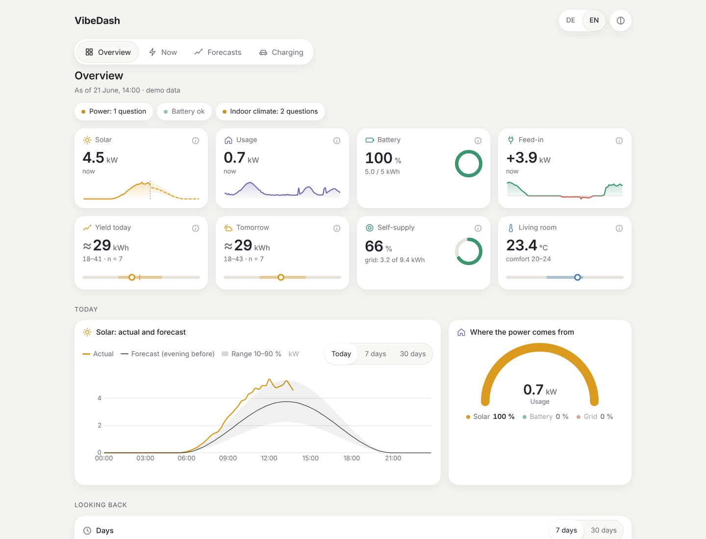
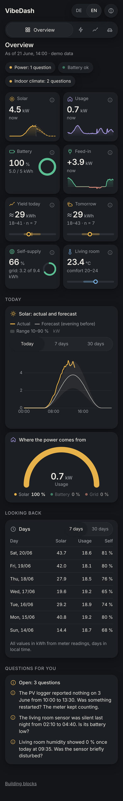
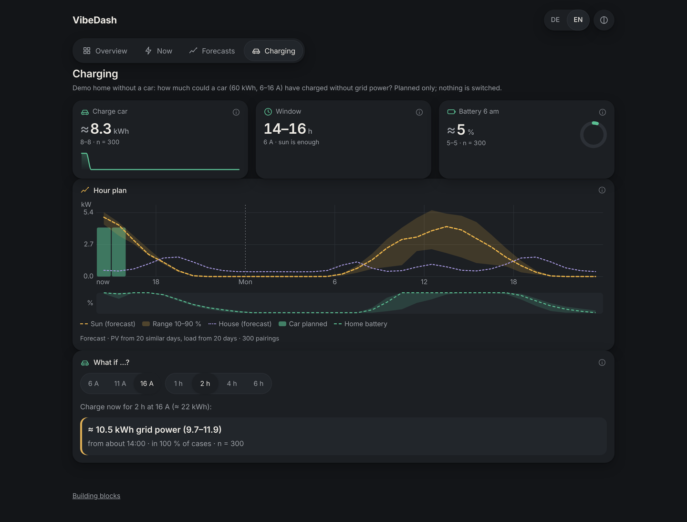
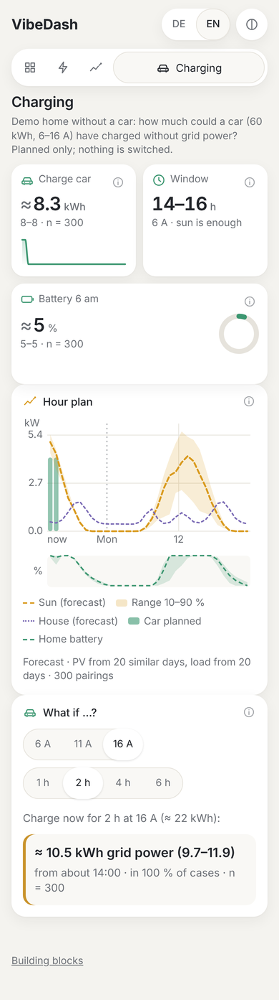

# VibeDash

Calm home dashboards for smart homes, solar, heat pumps and EVs – composed by an AI agent
from a fixed set of design building blocks, on top of checked data.

VibeDash is not one big app. It ships three things:

1. a **design language** (building blocks: tiles, sparklines, progress bars, …),
2. **data adapters** (demo data, InfluxDB 1.x, Home Assistant and evcc),
3. a **build guide for the agent** that assembles one dashboard per home.

Everything runs locally. No cloud, no CDN.

> Status: early. Pages Overview, Now, Forecasts and Charging (charge plan, stage A)
> and a gallery of all building blocks; synthetic demo data, or InfluxDB 1.x and/or Home
> Assistant via the server. Agent build guide incl. onboarding: [AGENT.md](AGENT.md) (German source: [INBETRIEBNAHME.md](INBETRIEBNAHME.md)). Project background and roadmap (German): [ANLEITUNG.md](ANLEITUNG.md).

<p>
  
  
</p>
<p>
  
  
</p>

All screenshots show the **synthetic demo household** – no real home.

## Try it in 15 minutes

With Docker (nothing else needed), the demo starts without any configuration:

```sh
git clone https://github.com/allawallabedalla/VibeDash.git && cd VibeDash
docker build -t vibedash .
docker run --rm -p 8080:8080 vibedash     # http://localhost:8080
```

Then connect your own data (next sections): copy `.env.example` to `.env`, create
`local/mapping.json`, start again with `--env-file .env -v "$PWD/local:/app/local:ro"`.
In someone else's home, go through [RISIKEN.md](RISIKEN.md) first.

## Quick start (development)

Requires Node 24 (current LTS) and pnpm 10.

```sh
pnpm install
pnpm dev          # http://localhost:5173 (#/, #/now, #/forecasts, #/gallery; ?lang=de|en, ?theme=light|dark)
```

## Connect your data (InfluxDB 1.x and/or Home Assistant)

The browser only talks to the VibeDash server. The server runs **only the named series**
listed in `local/mapping.json` – there is no way to send a query from the browser.

1. Create a **read-only** InfluxDB user for VibeDash (it never writes):

   ```sql
   CREATE USER vibedash_read WITH PASSWORD '…'
   GRANT READ ON "your_db" TO vibedash_read
   ```

   For **Home Assistant**, create a dedicated **non-admin** user and a long-lived access
   token for it (profile → Security). The normal HA history keeps 10 days by default;
   older data comes from HA's hourly long-term statistics (sensors with a `state_class`,
   switch off per series with `"longTerm": false`).

2. Copy `.env.example` to `.env` and fill in what you use (`INFLUX_*`, `HA_URL`/`HA_TOKEN`).
   `.env` is git-ignored. Credentials never go into the URL.
3. Create `local/mapping.json` (git-ignored) from `local/mapping.example.json` (Influx) or
   `local/mapping.example.homeassistant.json` (HA); sources can be mixed per series.
   `pnpm build && pnpm inventory` prints a read-only **draft** from Home Assistant and lists
   Influx measurements – check every entry before saving it. The file is checked at start; any typo or
   unknown key stops the server with a clear message.
4. Build and start:

   ```sh
   pnpm build
   pnpm start        # http://localhost:8080
   ```

Without `local/mapping.json` the server runs in demo mode.

Optional keys per series: `device` groups the questions (e.g. "inverter"), `maxPerDay`
leaves out implausible days of a meter, `helper: true` makes a series only an input for
others. A meter reading that drops (often to 0) or jumps and comes back within 10 minutes
is treated as a read error, not a reset. No meter for something (e.g. the house load)?
A **derived** counter sums up power and/or other meters – always named as such behind ⓘ:

```json
"load_energy": { "source": "derived", "name": "House", "kind": "energy_counter", "unit": "kWh",
  "stepMs": 60000, "terms": [{ "integrate": "load_power" }, { "counter": "car_energy", "sign": -1 }] }
```

New values are shown as **"being checked"** until you compared them with something you trust
(vendor app, meter) and set `"confirmed": true` for that series in `local/mapping.json`.
A sensor that stopped reporting shows **"data missing since …"** instead of an old number.

Home Assistant stores state **changes**: an unchanged value is held (it is still valid),
`unavailable`/`unknown` become visible gaps, and a value is held at most 24 h
(`maxHoldMs`) so a device that goes silent does not look alive.

API (read-only, `GET` only): `/api/health`, `/api/entities`,
`/api/series/<name>?range=1h|24h|7d|31d`, `/api/plan`, `/api/plan/guete`. Every Influx request times out after 10 s; the
page then shows "keine Daten" with the reason and a retry button, never endless loading.

## evcc (charging)

Set `EVCC_URL` in `.env`. A **Charging** tab appears with the wallbox right now and the
charging history that **evcc stores itself** (`/api/sessions`: kWh and solar share per
session) – no InfluxDB or Home Assistant needed for that. evcc's live values have no
history; for power/meter history use InfluxDB or Home Assistant.

**PV forecast and charge planning (M11/M12) need several weeks of hourly history**, so
InfluxDB or Home Assistant is a prerequisite there. No Influx and no HA? Run an InfluxDB
1.x container and switch on evcc's `influx:` output; VibeDash reads it with a read-only
user. For Home Assistant, VibeDash reads the **long-term statistics** (hourly, kept
without limit) for data older than 48 h – for sensors with a `state_class`; otherwise
raise `purge_keep_days`.

## Weather

The forecasts page shows a 7-day weather forecast from **Open-Meteo** (no key). Only the
house location, **rounded to about 1 km**, leaves the house. The location is found
automatically: `LATITUDE`/`LONGITUDE` in `.env` → `local/settings.json` → Home Assistant's
own location. If none is known, the page asks once: use the browser location (needs
`https` or `localhost`) or type a place. `WEATHER=off` disables all external requests.

## Forecasting service (optional)

`forecast/` is a small Python service (FastAPI + scikit-learn, SQLite) behind the VibeDash
server; the browser never talks to it. It follows `ANLEITUNG.md` section 11: rules of thumb
first, Ridge regression only if it beats them by ≥ 2 standard errors (paired), the same
2-day lead in the backtest and live, the first scheduled forecast per day counts, accuracy
as 100 % minus the mean size of the error – shown as "collecting data", "open · n" or a
percentage with trend.

```sh
cd forecast && uv sync && uv run python -m vibedash_forecast   # listens on 127.0.0.1:8090
```

Then set `FORECAST_URL=http://127.0.0.1:8090` in `.env` and name daily forecasts in
`local/mapping.json`:

```json
"forecasts": { "pv_tag": { "from": "pv_energy", "weather": true } }
```

Every hour the server sends complete days (from the meter reading) and, with
`"weather": true`, the weather forecast for coming days as features known in advance.

## Charge plan (stage A: plan and show)

The **Charging** tab shows how much the car can charge **without grid power** – now,
tonight and tomorrow – from the hourly PV forecast, a load forecast (temperature,
weekend), 300 paired scenarios and an hourly battery simulation (`LADESTEUERUNG.md`). A
charging hour is only planned if, in 30 of 31 cases, it causes no extra grid import, also
not later because the home battery would be empty. Tiles: kWh with range and n, window and
current, battery tomorrow 6 am; an hour chart; and **"what if …?"** (charge now with 6–16 A
for 1–6 h), computed in the browser on the same scenarios. The forecasts page shows the
plan's accuracy from a backtest that replans hourly like live.

**VibeDash never switches the wallbox.** Control (stage B, M13) needs ≥ 4 weeks of stage A
without wrong plans, the grid-operator question settled and every rule from
`LADESTEUERUNG.md` §7 – it is not part of v0.x.

Needs the forecasting service, `pv` in `local/mapping.json` and:

```json
"plan": {
  "load": "load_energy", "carEnergy": "car_energy", "soc": "battery_soc",
  "battery": { "capacityKwh": 10, "maxChargeKw": 5, "maxDischargeKw": 5, "minSocPct": 5, "reserveKwh": 2 },
  "vehicle": { "capacityKwh": 60, "phases": 3, "minA": 6, "maxA": 16 }
}
```

`load` is the house counter, `carEnergy` (optional) the wallbox counter that is subtracted
and gives "charged today". At least 21 days of hourly history are needed. The demo computes
everything in the browser for a made-up car (the demo home has none).

## Docker

```sh
docker build -t vibedash .
docker run -d -p 8080:8080 --env-file .env -v "$PWD/local:/app/local:ro" vibedash
```

Or copy `compose.example.yaml` to `compose.yaml` and run `docker compose up -d` (VibeDash +
forecasting service; the service gets no published port). The VibeDash image is based on
`node:24-alpine`, runs as a non-root user and contains no `node_modules` at runtime; the
forecasting image (`python:3.13-slim`) is about 1 GB because of scikit-learn/NumPy.
Without `local/mapping.json` VibeDash starts in demo mode.

## Scripts

| Command            | What it does                                                |
| ------------------ | ----------------------------------------------------------- |
| `pnpm lint`        | ESLint + Prettier check                                     |
| `pnpm check`       | Type check (svelte-check)                                   |
| `pnpm test`        | Unit tests (Vitest)                                         |
| `pnpm build`       | Static build into `dist/`, server into `dist-server/`       |
| `pnpm start`       | Run the server (serves `dist/` and the API)                 |
| `pnpm inventory`   | Read-only draft mapping from Home Assistant / Influx        |
| `pnpm budget`      | Fail if the first page loads more than 200 KB JavaScript    |
| `pnpm test:visual` | Screenshots Mac 1440×900 and iPhone 390×844, light and dark |

Screenshots are written to `screenshots/` (and uploaded as a CI artifact) to be looked at
by a person. The visual test also checks: no horizontal scrolling, no emoji, touch targets
≥ 44 px, text ≥ 14 px on the phone, and that ⓘ opens on tap, not on hover.

## Layout

```
src/model/       data model (entities, series, forecasts, ratings) and helpers
src/demo/        synthetic demo household with deliberate gaps and a sensor artifact
src/components/  building blocks (Tile, Sparkline, Progress, …)
src/i18n/        German and English UI texts
src/styles/      design tokens, light and dark
src/app/         app shell, router, shared tile definitions, data questions
src/pages/       Overview, Now, Forecasts, Charging (charge plan + evcc)
src/gallery/     gallery page
src/adapters/    InfluxDB 1.x and Home Assistant adapters (pure, tested with fixtures)
server/          read-only Node server: config, mapping schema, API, static files
local/           your mapping.json (git-ignored); mapping.example.json is made up
forecast/        forecasting service (Python): ladder, backtest, honest accuracy
tests/unit/      Vitest
tests/visual/    Playwright
```

## Building blocks

| Component        | Purpose                                                             |
| ---------------- | ------------------------------------------------------------------- |
| `Tile`           | value + 1–2 words + one small graphic (ring, scale, spark), ⓘ       |
| `TileRow`        | 2–6 tiles; two per row on the phone                                 |
| `Sparkline`      | soft line, optional range band, gaps stay open                      |
| `Progress`       | bar 0–100 % with a word; "open" instead of a fake 100 %             |
| `AccuracyCard`   | model accuracy: bar, trend, n, level (good / fair / poor / open)    |
| `DayList`        | days as rows like a weather app, yield with range                   |
| `SoftTimeSeries` | uPlot: actual line, separate forecast line with band, period pick   |
| `SourceArc`      | where the power comes from right now (sun / battery / grid)         |
| `StatusBar`      | areas as calm dots; colour only when action is needed               |
| `Tabs`           | main areas; compact icon bar on the phone                           |
| `Explanation`    | content behind ⓘ: what it means, where the number comes from        |
| `PlanChart`      | charge plan per hour: PV band, house load, charging blocks, battery |

## Principles

- First level is tiles with a small graphic; tables only as a second section.
- Every approximation shows its range and n. Forecasts get their own line.
- Gaps stay visible. Meter readings beat integrated power.
- Hints only when action is needed.

## Privacy

No real household data in this repository – no addresses, IPs, floor plans or
screenshots of real homes. Credentials belong in `.env` (git-ignored).

## License

[MIT](LICENSE) © allawallabedalla
